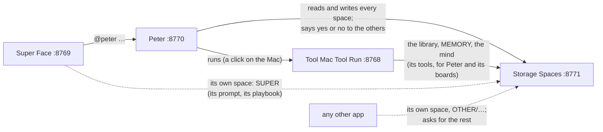

# How it fits together: Super Face, Peter, Tool Mac Tool Run, Storage Spaces

Four apps on one Mac, each with one job:

| App | Repository | Port | Its job |
|---|---|---|---|
| **Super Face** | [JUST-super-mac-tts-ONLY-service](https://github.com/ainigh/JUST-super-mac-tts-ONLY-service) | 8769 | The face and the conversation. It asks Peter. |
| **Peter** | [tool-mac-tool-run-agent](https://github.com/ainigh/tool-mac-tool-run-agent) | 8770 | Reads requests in plain words and carries them out. Keeps the time. Lets apps into the storage. |
| **Tool Mac Tool Run** | [tool-mac-tool-run](https://github.com/ainigh/tool-mac-tool-run) | 8768 | The hands: scripts, flows, the web, Chrome. A run waits for Run on the Mac. |
| **Storage Spaces** | [tool-mac-tool-run-storage-spaces](https://github.com/ainigh/tool-mac-tool-run-storage-spaces) | 8771 | What's kept: the person's library, MEMORY and mind; Super Face's prompt and memory; Peter's schedule and status; what's waiting for approval. |

## The brief

What was asked (this repository's first README), its words lightly tidied:

> storage spaces for the system managed by tool-mac-tool-run-agent. it contains user, peter,
> super, pending. user space contains mind, memory, library. super space contains prompt,
> memory (for the agent). peter contains the storages that peter needs to work (scheduling,
> status, etc). other, not used for now. storage will also have api that peter will use to
> write. peter in tool-mac-tool-run-agent can allow access to any of the memory (read/write) if
> any client ask for it. it should also have reset to factory button. goal is to move the
> storages from tool-mac-tool-run into here, part of the effort like how we moved things into
> tool-mac-tool-run-agent. i may have gaps, help me organize it better, make the judgement calls
> on what other names or types to add etc. close the gaps on my behalf.

## The judgement calls (the gaps, and how they're closed)

| Gap | Closed by |
|---|---|
| What kinds of storage there are | Four kinds of store: **notes** (Markdown by name, with a Trash: the library's operations), **memory** (notes that are nodes of the mind, with remember and recall), **mind** (the append-only log), **records** (JSON by key, with versions). Each store of each space is one of them, with the same routes as any other of its kind. |
| What Peter needs "to work" | **SCHEDULE** (his schedule), **STATUS** (how things stand), **FOLLOWING** (the runs he's following: today they're only in memory, so a restart loses the callback; kept here they outlast it), **SETTINGS** (his model, where Tool Mac Tool Run is). Records, because his things are JSON and two of his threads may write the same one: the version stops one overwriting the other unseen. |
| What "pending" holds | What's waiting for a yes or a no: **REQUESTS** (an app asking for access) and **WRITES** (a change held until it's approved, `"hold": true`), kept as records so they outlast a restart, decided only through `/api/access/requests` and `/api/pending`. |
| What "other" is | Any other app's own folder of notes, made the first time it writes (`other/super-voice`). Nothing uses it yet; it's there so a new app needn't be given someone else's space. |
| What Super Face's "prompt" and "memory" hold | The two notes it kept in Tool Mac Tool Run's library: **PROMPT/instructions** ("Super Face instructions": the person's standing instructions) and **MEMORY/playbook** ("Super Face playbook": what it has learned), with the same first lines. What it knows about the person stays in USER/MEMORY (the node "the user"), as before. |
| How "Peter can allow access" works without being a password | Rules, then grants. Peter may read and write everything; an app its own space; the rest it asks for, and Peter (or the person, or a space's owner for its own) says yes: read or write, a space or one store, for a while or for good. Every grant is listed in the window and can be taken back. |
| An app claiming to be Peter | An app can claim its name with a key (`POST /api/clients/register`); from then on, a request in that name without the key is turned down. The person can forget a key (so a reinstalled app can register again). Only its hash is kept. |
| Tool Mac Tool Run losing its own storage | It's given a grant from the start: it may read and write USER (the library, MEMORY and the mind were its own), so it can keep its boards and tools working through the same API, on another port. |
| Moving the storage without breaking anything now | The first launch **copies** (never moves) Tool Mac Tool Run's LIBRARY, MEMORY and MIND, and Peter's schedule.json and model.json, into the spaces. The originals stay as they were, and keep being used, until each app is changed to use Storage Spaces. A note that already differs here comes in beside it, as "NAME (from Tool Mac Tool Run)"; two minds are never merged. |
| Knowing when something changed (Super Face's prompt edited by hand, a request for access) | `GET /api/changes?after=N&wait=25`: numbered changes, waited for, filtered to what the asker may read. |
| The factory reset | **Factory Reset…** in the menu (Tool Mac Tool Run's, taken over): every space to the Trash (so it can be had back), the settings forgotten, the app opens again as installed, and doesn't import Tool Mac Tool Run's things by itself again. A single space can be reset too (its owner or Peter; USER by the person alone). |
| Where it lives on disk | `~/Desktop/STORAGE-SPACES`, beside TOOL-MAC-RUN, in plain files the person can open, with a README in it saying what each folder is (`STORAGE_HOME` puts it elsewhere). `.storage` (hidden) holds the access rules, the keys and the import's report. |
| Updates, the icon, install | As Peter and Tool Mac Tool Run do: a menu bar icon (filled while something waits), an updater that checks at launch and every six hours (GitHub's build when there is one, else built on the Mac), `install.sh`, CI that tests on Linux and releases on macOS from `main`. |

## What changes in the others (once greenlit)

Nothing here needs them changed to run: Storage Spaces works on its own, and the others go on
using their own storage until they're changed. When it's time:

1. **Tool Mac Tool Run**: its library, MEMORY and mind go through Storage Spaces
   (`http://127.0.0.1:8771`, as `Tool Mac Tool Run`, which may already write USER): `FileLibrary`,
   `Memory` and `MindStore` behind a small client, or its `/api/library`, `/api/memory` and
   `/api/mind` (and the `library`, `remember`, `recall` tools) passed on as they are. Its boards
   read and write through the same. TOOL-MAC-RUN keeps SYSTEM-DOCS (its own docs). Its factory
   reset stops taking the library, MEMORY and the mind with it (they're Storage Spaces' now).
2. **Peter**: his schedule, status, the runs he's following and his settings move to PETER's
   records (he registers his name with a key on his first launch, and keeps it in his
   Application Support). He watches `GET /api/changes?space=pending&wait=25` and answers requests
   for access (his model, or his rules: "Super Face may read MEMORY", asking the person when
   unsure). His templates gain the storage's own ("remember that…", "what do we know about…",
   "read the note…") straight from here, not through Tool Mac Tool Run.
3. **Super Face**: its two notes come from SUPER (PROMPT/instructions, MEMORY/playbook), in its
   own space, without asking; what it knows of the person, through Peter, as now.
